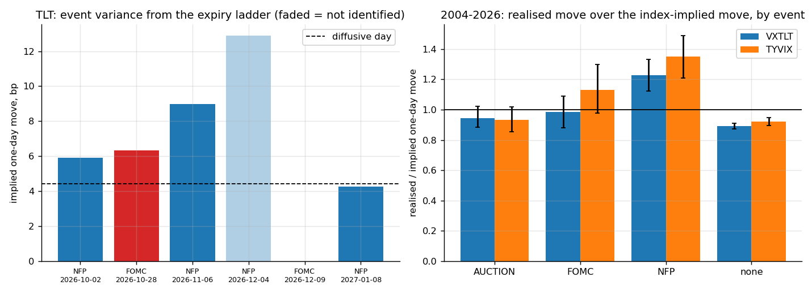
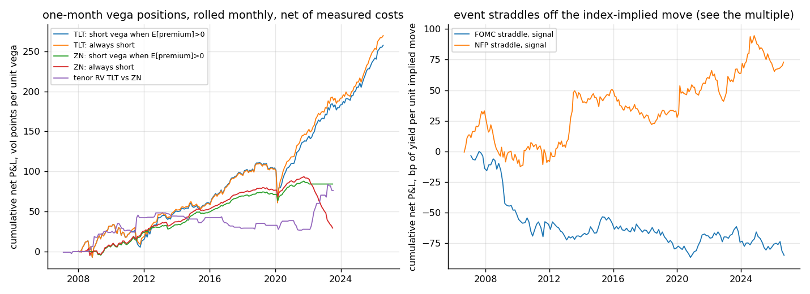

# rates-vol-cube

A basis-point vol cube built from listed Treasury-ETF option chains, an event-variance extraction from the expiry ladder, and a test of four relative-value trades in rates volatility with measured taking costs. Python with DuckDB; chains from Cboe delayed quotes, histories from Cboe, Yahoo and the Treasury.

The question: can a rates vol desk's toolkit be built and tested on free data, and which standard rates-vol trades survive the cost of taking?

## Results

- **Cube.** On 2026-09-18 the TLT chain (26 expiries, 853 two-sided quotes) gives a one-month ATM normal vol of **73.5 bp** against MOVE 76.2. IEF is 82.7 and SHY 154, but SHY has two expiries and 13 quotes. Normal SABR per expiry has a median error of 4.7 bp vol. Empirical durations agree with the sponsors' (TLT 14.4 vs 15.0, IEF 7.0 vs 6.9, SHY 1.7 vs 1.8).
- **Events.** The ladder prices an event day at **1.75× (FOMC) / 1.67× (NFP)** a normal day. Over 2004–2026 realised over index-implied move is 0.89 [0.87, 0.91] on ordinary days, 0.99 [0.88, 1.09] on FOMC days and **1.23 [1.12, 1.33] on payroll days**.
- **Premium.** Implied minus next-21-session realised vol is **+1.4 vol points [1.0, 1.8] on TLT**, +0.3 [0.1, 0.5] on the 10y future, +1.9 bp [−0.2, 4.0] for MOVE and +12 bp [8, 15] for 1y10y swaptions. Adding implied vol to a HAR-RV forecast lifts out-of-sample R² from 0.34 to 0.43 on TLT.
- **Two trades survive costs.** Short one-month TLT vega costs 0.26 vol points round trip and makes +1.15 vol points per month [0.56, 1.68], Sharpe 0.87, with a 49-point drawdown in March 2020. On the 10y future the signal is the trade: +0.45 [0.26, 0.67], Sharpe 1.10, against +0.16 [−0.19, 0.52] always short.
- **The event trade is a trap.** Priced off the 30-day index, the payroll straddle looks like a buy (+0.77 bp [0.23, 1.34]). Priced at the ladder's 1.67× multiple it is a sell (−2.5 [−3.1, −1.9]). Tenor RV mean-reverts but nets +0.39 [−0.00, 0.87].

| fund | D | expiries | quotes | ATM bp vol 1m / 3m / 6m | median fit error (bp vol) |
|---|---|---|---|---|---|
| IEF | 7.0 | 12 | 288 | 83 / 91 / 89 | 7.8 |
| TLT | 14.4 | 26 | 853 | 74 / 79 / 78 | 4.7 |




All numbers are in `results/summary.md`; the detail is in [docs/method.md](docs/method.md).

## How it works

- **bp vol.** Each quote is solved for its Bachelier vol on a forward from put–call parity, then converted to yield bp through an empirical duration (a rolling regression on the CMT yield). Slices are fitted with normal SABR.
- **Event variance.** Non-negative least squares on total variance across expiries gives a diffusive vol and an implied one-day move for each scheduled event. Two events in one interval are flagged as unidentified.
- **Premium.** Implied minus forward realised vol with block-bootstrap intervals, and HAR-RV forecasts with and without implied vol, walk-forward.
- **Trades.** P&L is vega times (realised minus implied). Costs are the chain's ATM half-spread on entry and exit plus hedging, with ×2 and ×4 sensitivities.

## Limitations

- The P&L is the variance-swap approximation of a delta-hedged option, and today's spreads are applied to 2008–2026.
- The event multiple comes from the chains recorded so far (one day) and is applied to the whole history.
- ETF options are American, treated as European on out-of-the-money quotes. SHY, IEI and TLH have two expiries each.
- CME Treasury and SOFR options and swaption surfaces are not free, so the same code would need calibrating on desk data.

## Run

```
pip install -e .[test]
python -m pytest
scripts/run_all.sh            # download, record chains, run, figures, summary, notebook
```

The chain recorder (`python tools/record.py --loop 1800`) should run daily, because chain history cannot be downloaded later. CI runs the 23 tests and the whole pipeline on the checked-in data and a sample chain.
